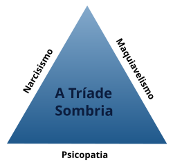
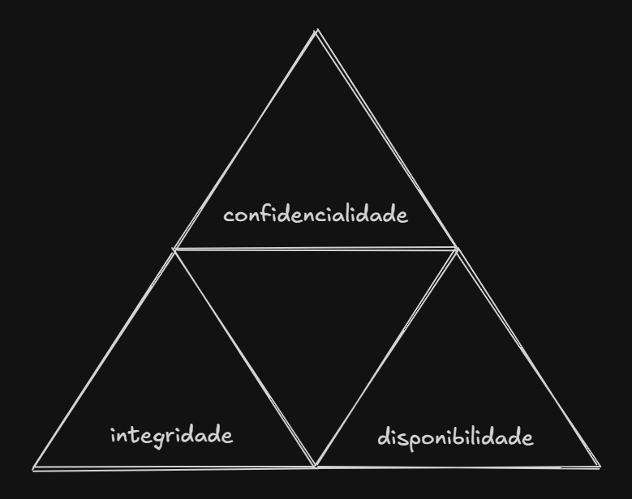

## Parte 1: Introdução

Você sabe dizer o que é cibersegurança com as suas palavras? Sabe quais são as subáreas e o que os profissionais fazem?

### Cibersegurança ou Segurança da Informação?

Primeiro, vamos começar entendendo que segurança da informação e cibersegurança são termos comumente usados como sinônimos, mas são diferentes. Segurança da informação é **abrangente**, inclui a segurança dos dados de uma empresa, inclusive de forma física. Cibersegurança (ou segurança cibernética) é um ramo de segurança da informação, esse sim **focado no contexto digital**. Isso importa muito? Não tanto, pois são usados no mesmo sentido no dia a dia. Saber disso te ajuda a entender que você pode pesquisar usando os dois termos sem medo em buscas de emprego.

### Tríade de Segurança da Informação

Como acontece em qualquer área de TI, segurança da informação é dividida em subáreas, e todas elas existem com o objetivo de assegurar o que chamamos de **tríade CIA** (CID em pt-BR, mas ninguém chama assim) de segurança da informação: confidentiality, integrity e availability (confidencialidade, integridade e disponibilidade).

<figure>
    
    <figcaption>Oops... tríade errada. Fonte: Wikipedia</figcaption>
</figure>

<figure>
    
    <figcaption>Ok, essa é a tríade correta.</figcaption>
</figure>

- **Confidencialidade:** garante que a informação seja acessada apenas por pessoas autorizadas.
- **Integridade:** garante que a informação seja mantida de forma correta e completa, sem alterações não autorizadas.
- **Disponibilidade:** garante que a informação esteja disponível para acesso quando necessário.

Perguntas rápidas:

  
Um hacker consegue acessar os dados de uma empresa e alterá-los. Qual princípio da tríade foi violado?

  Resposta: Integridade

  
Um funcionário consegue acessar dados de clientes que não deveria. Qual princípio da tríade foi violado?

  Resposta: Confidencialidade

  
Um cliente percebe que consegue baixar comprovantes de outros clientes. Qual princípio da tríade foi violado?

  Resposta: Confidencialidade

  
Um servidor de uma empresa fica fora do ar por 3 dias. Qual princípio da tríade foi violado?

  Resposta: Disponibilidade

Quando estudamos essa pirâmide, logo aprendemos que sua base está pautada em outros três pilares: **pessoas, processos e tecnologia**. A segurança da informação não é apenas sobre tecnologia, mas também sobre como as pessoas interagem com ela e os processos que garantem sua eficácia.

Empresas são organismos complexos, principalmente considerando que dificilmente elas iniciam suas operações com a segurança da informação como prioridade. Por isso, é comum que profissionais de cibersegurança encontrem desafios relacionados à cultura organizacional, resistência a mudanças e falta de conscientização sobre a importância da segurança. São esses desafios que reforçam a necessidade desses pilares.

- Não adianta ter a melhor tecnologia se as pessoas que a utilizam não estão cientes dos riscos e das melhores práticas.
- Não adianta ter processos bem definidos se a tecnologia não é capaz de suportá-los ou se as pessoas não os seguem corretamente.
- Não adianta ter pessoas bem treinadas se não há processos claros e tecnologia adequada para apoiar suas ações.

Sem esses pilares, a tríade de segurança da informação não pode ser efetivamente protegida. Portanto, iniciar na área **vai além dos desafios técnicos**, do conhecimento de ferramentas ou da vontade de quebrar sistemas. É necessário compreender o contexto em que a segurança da informação se insere, incluindo aspectos humanos, organizacionais e tecnológicos.

- <a href="https://www.fortinet.com/br/resources/cyberglossary/cia-triad" target="_blank">Aprenda mais sobre a tríade de segurança da informação</a>

### Times de Cibersegurança

Existem diferentes times de cibersegurança dentro de uma empresa ou contratados por meio de consultorias. Cada time tem um foco específico, mas todos trabalham juntos para proteger a informação e os sistemas da organização. Majoritariamente, você vai encontrar bastante menção a dois deles:

- **Blue Team:** também é conhecido como **"segurança defensiva"**. É o Blue Team que arquiteta, toma decisões, implementa ferramentas de segurança, impõe a conformidade, e, claro, defende quando ataques ocorrem (principalmente, evita que ocorram). Também faz resposta a incidentes e forense. Como não é retratado em filmes como o anti-herói encapuzado, não é uma área pela qual o iniciante sente grande empolgação.

- **Red Team:** também conhecido como **"segurança ofensiva"**, "pentest" ou "hacking ético". É quem, sob contrato, testa a segurança de uma empresa para medir a sua maturidade. Esses testes podem ocorrer com o conhecimento de todo o time de segurança do cliente (white/gray box), ou somente com a anuência do contratante, mas não do time todo (black box). O Red Team é muito importante como um olhar fresco, tendo em vista que quem projeta costuma não pensar em todas as alternativas em que a regra de negócio pode ser quebrada, fora as falhas técnicas que costumam passar despercebidas (mesmo que minimizadas quando existe processo de DevSecOps).

*É importante mencionar que tarefas de um time ou outro, como pentests, podem ser realizadas por times mais abrangentes, como AppSec.*

Algum time é mais importante do que o outro? **Absolutamente todos são importantes**, mas atribuições geralmente vinculadas à segurança defensiva são imprescindíveis, pois a segurança de uma empresa não pode depender apenas de testes periódicos. Por outro lado, a segurança ofensiva é **essencial** para identificar vulnerabilidades que podem passar despercebidas, ajudando tanto a segurança defensiva, quanto os desenvolvedores a melhorar a segurança dos sistemas.

### Lição de casa para essa primeira parte

Ler sobre: 

- <a href="https://www.mentebinaria.com.br/guia-de-estudos-e-profissoes/" target="_blank">profissões em cibersegurança</a>

Pesquisar sobre:

- *Quais são as áreas dentro de Blue Team?*
- *Quais são as áreas dentro de Red Team?*
- *Quais são os outros times além de Blue Team e Red Team?*
- *O que é "regra de negócio" e como se diferencia de "falhas técnicas"?*
- *Qualquer termo que não tenha entendido nesse texto ou nos textos acessados.*

## Parte 2: Aprendendo a pesquisar e a perguntar

Uma das coisas que vem de brinde com a carreira de TI, e em cibersegurança não é diferente, é a **habilidade de pesquisar**. Qualquer profissional passa horas a fio pesquisando como implementar, consertar, ou quebrar alguma coisa (mesmo com a IA).

Cibersegurança é essencialmente uma **área investigativa**. Você investiga pra proteger, investiga pra atacar.

É, portanto, uma **área para curiosos**.

Além disso, a habilidade de pesquisar permite que a pessoa tenha mais proatividade, uma das posturas mais admiradas, seja no trabalho ou fora dele.

Por isso, é importante que você aprenda a pesquisar de forma eficiente, como, por exemplo, utilizando **Google Dorks**, que são técnicas de pesquisa avançada no Google (também implementadas em outros mecanismos de busca) para encontrar informações específicas.

- <a href="https://kinsta.com/pt/blog/operadores-de-busca-do-google/" target="_blank">Aprenda mais sobre operadores de busca do Google</a>

Entretanto, de nada adianta saber utilizar ferramentas de pesquisa se você não sabe *como perguntar*. Perguntar de forma clara e objetiva é uma habilidade que pode ser desenvolvida com prática.

- <a href="https://web.archive.org/web/20240210105845/https://questions.icon-library.com/perguntas.html" target="_blank">Aprenda a fazer perguntas de forma clara e objetiva</a>

Ok. Agora você sabe pesquisar, fazer perguntas e persistir na sua pesquisa do seu tópico de interesse. E agora?

Agora o céu é o limite.

Você pode, por exemplo, ir no LinkedIn usar dorks na busca de lá pra encontrar vagas em cibersegurança, e checar o que é pedido pelas empresas nas mais diversas áreas de sec.

### Lição de casa para a parte 2:

- Pesquisar vagas de segurança (seja no LinkedIn ou fora dele) e checar o que as vagas pedem.
- Pedir para a IA criar pesquisas com dorks para te ajudar a encontrar vagas em cibersegurança (pode especificar pra uma subárea desejada dentro de segurança). Você vai copiar o que ela encontrar e colar nas buscas
- Pesquisar pelos termos desconhecidos nas vagas encontradas
- Avaliar o que mais te interessa

## Parte 3: Enfim, como começar?

Finalmente, a tão aguardada pergunta:

Mas como raios eu começo? 

Aqui, vale mencionar a importância da **boa compreensão do inglês**. Não é necessário saber falar (apesar de ser uma vantagem), mas, ao menos, compreender. A maior parte dos cursos e termos são em inglês.

Antes de vasculhar os diversos cursos disponíveis, vale ler esse post aqui do Fernando Mercês, tem muita informação:

- <a href="https://www.mentebinaria.com.br/artigos/tudo/como-ser-um-bom-profissional-em-seguran%C3%A7a-da-informa%C3%A7%C3%A3o-r32/" target="_blank">Como ser um bom profissional em segurança da informação?</a>
 
Talvez você já saiba, mas redes é um dos pilares de segurança da informação, como você também pode checar no excelente site roadmap.sh:

- <a href="https://roadmap.sh/cyber-security" target="_blank">roadmap.sh/cyber-security</a>

Nesse site é possível "checklistar" tudo o que for aprendendo. Ele também te direciona pra alguns links interessantes onde você pode aprender sobre o tópico.

Caso não reconheça algum termo, o que é super normal, use o que aprendeu na parte 2 e pesquise bastante.

Agora, nada é tão inicialmente completo (se tratando de cursos de cybersecurity) quanto os cursos da Cisco, que são **gratuitos**:

- <a href="https://www.netacad.com/cybersecurity" target="_blank">www.netacad.com/cybersecurity</a>

No link acima, é muito recomendado que faça ao menos o Introduction to Cybersecurity e o Cybersecurity Essentials. Ao terminar, saberá o que responder sobre redes em uma entrevista direcionada a estagiários ou até mesmo Júnior I.

Sobre livros, o Mercês já indicou alguns, mas também tem o bom e velho Tanenbaum, que escreveu alguns dos mais essenciais em redes e sistemas operacionais. 

Também é recomendado que aprenda virtualização e faça uma rede emulada (ou, se tiver dispositivos em casa, faça o seu laboratório caseiro!).

Depois, é interessante que aprenda alguma linguagem de programação e saiba fazer um CRUD, um site simples com algumas áreas e formulários. Pesquise e entenda como injeções (XSS, SQL) ocorrem, e como mitigar.

Os sites abaixo são excelentes para entender sobre vulnerabilidades web e outros tópicos:

- <a href="https://portswigger.net/web-security" target="_blank">portswigger.net/web-security</a> - PortSwigger é dona do Burp Suite. Os laboratórios são gratuitos, focados em vulns web.
- <a href="https://tryhackme.com" target="_blank">tryhackme.com</a> - THM tem salas gratuitas, mas é majoritariamente pago. Tem desconto para estudantes (que possuam e-mail estudantil). Labs diversos, não apenas web. Salas para ambos Red Team e Blue Team.
- <a href="https://www.hackthebox.com" target="_blank">hackthebox.com</a> - As trilhas do HTB são excelentes. Não apenas web. Focado em Red Team.
- <a href="https://letsdefend.io" target="_blank">letsdefend.io</a> - Focado em Blue Team. 

E existem também roadmaps diversos, além do já mencionado roadmap.sh:

- <a href="https://github.com/isaqueprofeta/cybersec-path" target="_blank">github.com/isaqueprofeta/cybersec-path</a>
- <a href="https://meninadecybersec.notion.site/Iniciando-em-Cybersecurity-e-Seguran-a-da-Informa-o-cfe02d5ac2b74576b315083387894890" target="_blank">meninadecybersec.notion.site/Iniciando-em-Cybersecurity-e-Seguran-a-da-Informa-o-cfe02d5ac2b74576b315083387894890</a>
- <a href="https://wiki-cantinho-da-offsec.gitbook.io/roadmap" target="_blank">wiki-cantinho-da-offsec.gitbook.io/roadmap</a>
- <a href="https://github.com/arthurspk/guiadecybersecurity" target="_blank">github.com/arthurspk/guiadecybersecurity</a>
- <a href="https://github.com/gracenolan/Notes" target="_blank">github.com/gracenolan/Notes</a>

Ok, viu tudo isso e ainda se pergunta como começar?

Com um conhecimento básico, você pode pesquisar por vagas (como aprendido na parte 2), especialmente de SOC, mas também outras do seu interesse. SOC é a área em sec que **mais tem vagas entry level**, por isso costuma ser o foco de quem está tentando entrar diretamente.
 
Outra estratégia é entrar em uma empresa que tenha área de sec, mas em outro cargo, como suporte ou infra, e depois tentar migrar para a área desejada. 

Para quem já tem anos de carreira em outra área e não pode diminuir o salário entrando como estagiário ou júnior, a situação é mais delicada. Seria interessante conseguir um QI (Quem Indica). Outra alternativa é tirar certificações requisitadas, mas tenha em mente que elas são caras e **não são garantia** de que você vai conseguir se realocar rapidamente.

**Para todos:** Também procurem sobre currículos ATS, usem muitas palavras-chave no LinkedIn e no currículo.

**Sobre faculdade:** Em resumo, ajuda a passar do filtro do RH. Pra estagiar, você precisa ser aluno de uma instituição reconhecida pelo MEC, caso contrário, pode se candidatar apenas às vagas normais (júnior e adiante). 

**Para quem está na faculdade ou está começando uma:** procure estágio **assim que possível**. Não espere se sentir preparado, não deixe para a última hora, vá na cara e na coragem. O mercado quer saber de experiência. Se formar sem estágio é um **erro gravíssimo**. Ninguém quer saber se você priorizou a faculdade e tirou 10.

**Para quem mora em locais isolados:** Pode ser mais difícil conseguir trabalho, dado que vagas de sec se concentram em locais industriais ou tecnológicos, e as vagas remotas são muito disputadas. Analise muito bem a sua situação e faça planos sólidos.

No mais, tentem. Não esperem o sentimento de estar preparado. **Ele nunca vem.** 

Agora é com você. A sua lição de casa é **pesquisar tudo, absolutamente tudo** o que te interessar nesses links. :)
