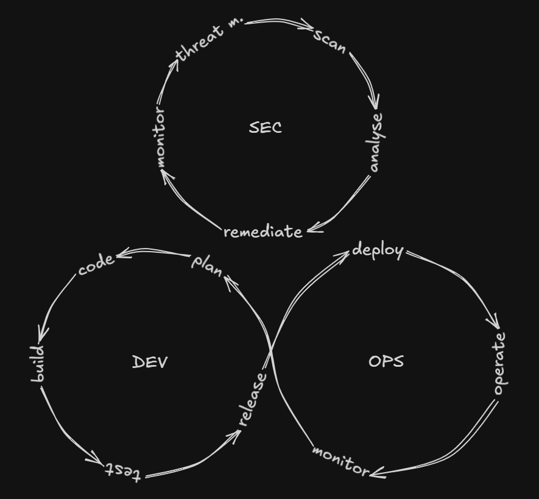

Existem tantas subáreas dentro do guarda-chuva de TI que pode ser **difícil para um iniciante escolher** entre desenvolvimento, automação, dados, infraestrutura ou segurança da informação, só para citar algumas, cada uma com muitos outros galhos de possibilidades de carreira.

Segurança da informação, por exemplo, costuma ser dividida em times, dos quais dois deles são: **Blue Team**, que trata da **segurança defensiva**, monitorando o tráfego da rede, assegurando a proteção de endpoints, configurando ferramentas de segurança e realizando respostas a incidentes, entre muitas outras atividades; e **Red Team**, que atua em **segurança ofensiva**, realizando ataques simulados para testar a maturidade de segurança da empresa que contratou o serviço, em busca de vulnerabilidades, pontos de entrada para intrusão e equívocos nos processos e nas regras de negócio, agindo como um atacante (ou *hacker*, termo cunhado popularmente).

<figure>
  
  <figcaption>Muitas pessoas tendem a simplificar a escolha entre Red Team e Blue Team, como se a realidade fosse igual ao dilema das pílulas de Matrix — só a vermelha valesse a pena. Fonte: Matrix, 1999.</figcaption>
</figure>

Não é de surpreender que muitos iniciantes busquem um primeiro emprego em segurança ofensiva, afinal, é a subárea que serve como **vitrine de segurança**. Inúmeras mídias digitais já retrataram os infames hackers: séries como La Casa de Papel e La Femme Nikita (uma das minhas séries favoritas), ou filmes como Os Homens que Não Amavam as Mulheres e Who Am I apresentam esses personagens de forma sútil ou mais presente em diferentes épocas da existência digital, mas sempre ali, digitando rapidamente e quebrando qualquer sistema de proteção para invadir sorrateiramente ambientes sem que ninguém perceba, clichês catalogados em tropos como <a href="https://tvtropes.org/pmwiki/pmwiki.php/Main/HollywoodHacking" target="_blank">Hollywood Hacking</a> e <a href="https://tvtropes.org/pmwiki/pmwiki.php/Main/RapidFireTyping" target="_blank">Rapid-Fire Typing</a>. 

É muito raro que processos defensivos sejam retratados como acontece nos primeiros episódios de Mr. Robot, e, quando aparecem, geralmente se resumem a **homens de terno em escritórios acinzentados** — algo bem menos atrativo, principalmente em contraste com o **glamour e a adrenalina de invadir sistemas** e acessar informações que deveriam estar guardadas a sete chaves. O próprio personagem Elliot Alderson trabalhava em um emprego enfadonho como engenheiro de cibersegurança durante o dia, sendo uma espécie de anti herói hacker durante a noite, como vários personagens amados da Marvel ou da DC, que tem vidas muito mais interessantes quando assumem a outra personalidade.

<figure>
  
  <figcaption>A paleta cromática não mente: este é um ambiente tão maçante quanto as salas da Lumon. Fonte: Mr. Robot, Amazon Prime Video.</figcaption>
</figure>

Entretanto, a quantidade de vagas de entrada destinadas à segurança ofensiva é **inversamente proporcional** à vontade dos iniciantes em entrar nesta área — **são muito raras**. Algumas pessoas afirmam equivocadamente que isso ocorre por ser um campo de grande responsabilidade ou de necessidade de um grande conhecimento, mas isso não se aplica a qualquer área de TI? Afinal, um desenvolvedor júnior também lida com informações confidenciais (mesmo que idealmente em menor grau) e auxilia no desenvolvimento de ambientes que vão para produção. A diferença entre um cargo de entrada e um de nível avançado está justamente na necessidade de uma pessoa inexperiente ser supervisionada e compreendida como um profissional em fase inicial de evolução  — em qualquer ramo. 

O verdadeiro motivo para os cargos mais baixos em Red Team serem tão escassos está na natureza dessa área: os testes mais comuns — de vulnerabilidade web, mobile e cloud, por exemplo — costumam fazer parte do ciclo de desenvolvimento, integrando a segurança de aplicações (appsec). Embora seja muito importante que o ambiente seja testado de forma mais heterogênea por times externos, sem vícios, incluindo avaliações de engenharia social e testes Wi-Fi para preencher lacunas, esses são testes **pontuais, frequentemente anuais**, de custo variável a depender da abrangência do teste específico — e são caros. O que não pode ser pontual ou anual é a maturidade de segurança de uma organização, que sempre pode ser aprimorada, seja por meio desses testes externos ou por métricas e processos internos junto ao time de desenvolvimento e segurança; estes, sim, devem ser **contínuos, permanentes e de custo fixo** (ou dentro do orçamento recorrente esperado). Como a operação defensiva precisa ser contínua, **há muito mais vagas em Blue Team**, pois nem sequer haveria Red Team se não existisse um time defensivo que precisa estar ativamente coordenado. 

Engenheiros e arquitetos de segurança são **muito mais requisitados** do que membros de times ofensivos, porque este último serve justamente para testar a arquitetura de segurança já implantada pelos profissionais anteriores. Não apenas essas funções são **indispensáveis**, como também os analistas de SOC (Security Operations Center), que monitoram alertas e investigam comportamentos anômalos (apesar desta área estar em processo de automatização), além dos profissionais focados em segurança de aplicações, nuvem ou identidade, que trabalham diretamente com desenvolvedores e times de infraestrutura para reduzir riscos antes que eles cheguem à produção. São justamente esses profissionais que impedem que incidentes tomem grandes proporções, mesmo quando times ofensivos auxiliam, pois são eles que aplicam as correções e a arquitetura. Além disso, é necessário que as empresas sigam requisitos regulatórios e auditorias, o que independe do tamanho da organização. Essas definições são planejadas e colocadas em prática por equipes de segurança defensiva.

Vamos pensar no seguinte: uma empresa inicia um serviço digital sem pensar na segurança de sua estrutura. Mais cedo do que tarde, ela sofrerá um incidente que poderá, inclusive, **fechar as suas portas** antes mesmo que algum lucro seja alcançado. Pensemos que não apenas seus clientes serão prejudicados com uma possível invasão de contas ou exposição de dados, como também os colaboradores, que estarão desempregados ou também terão seus dados expostos. Antes que o pior cenário possível tenha chance de acontecer, essa empresa pode:

- Contratar uma **consultoria de segurança ofensiva** para entender quais são as brechas e como ela deve organizar sua arquitetura. Essa consultoria, se fizer um bom trabalho, deverá indicar quais tipos de profissionais contratar, a quantidade e para quê. 
- Contratar diretamente uma **consultoria de segurança defensiva** para auxiliar na conformidade, na segurança da rede, dos endpoints e nas demais necessidades de segurança cibernética, e só depois da casa minimamente estruturada, contratar o serviço ofensivo a fim de testar e aprimorar o sistema implantado. 

De uma forma ou de outra, a finalidade segue para o mesmo eixo: integrar medidas de segurança de **forma contínua** através de profissionais de segurança defensiva, seja de forma terceirizada ou não.

<figure>
  
  <figcaption>A abordagem DevSecOps pode se enquadrar em ambos os times, entretanto é orientada a incrementar a segurança no ciclo de desenvolvimento.</figcaption>
</figure>

É relevante mencionar que a segurança vai além destes dois times. O objetivo não deve ser apenas o de monitorar a rede e demais ativos, mas adotar a mentalidade **security by design**, orientando os desenvolvedores a empregarem modelos como shift left security (deslocando a segurança para o início do processo) ou integrando frameworks completos como o ciclo de vida do desenvolvimento de software seguro (SSDLC), transformando a maturidade de segurança em um objetivo diário no processo de desenvolvimento, com profissionais focados, para que só então as equipes de segurança ofensiva possam mensurar o quão protegido esse ambiente está efetivamente, com todas as bases de sustentação posicionadas. É nesse contexto que se insere a abordagem **DevSecOps**, que integra segurança em todas as etapas, do planejamento e codificação até o deploy, incluindo monitoramento e resposta a ameaças, com o propósito de garantir que a segurança seja contínua, automatizada e parte da cultura de desenvolvimento, e não uma etapa isolada ou posterior, como ocorre nas demais áreas quando desacopladas.

Em resumo: não dá pra chegar com o pé na porta, tendo a certeza de que o que você quer é Red Team, **sem antes entender a área, as suas necessidades e qual é o seu perfil** dentro desse universo tão amplo.

Então, como red teamer que gosta bastante da área (mas que também está tomando gosto por DevSecOps), deixo essa estranha provocação para quem está chegando agora: antes de ser influenciado pelo glamour de um lado e a falta de propaganda atrativa do outro, é importante que o iniciante **pense na realidade do mercado**. Vale pesquisar como é o dia a dia, os prós e contras, o que é aprendido e quais são as possibilidades de crescimento para o próprio perfil, afinal, se esse iniciante prefere implementar, projetar ou avaliar dados, é mais provável que, no final, seja mais aderente ao Blue Team ou outra frente do que ao Red Team, apesar do êxtase pela possibilidade de quebrar cadeados. É imprescindível examinar o que cabe nos planos futuros de carreira, **sempre com os pés no chão**. Há muito espaço para crescimento em Red Team, especialmente em consultorias e bancos, mas será que não há uma falta de considerar o quanto outras áreas de segurança também são uma alternativa interessante? E se não forem, tudo certo, no final você descobriu o que realmente queria seguir como carreira.

Que essa provocação não sirva como um desencorajamento, muito pelo contrário, que **ajude a esclarecer o que realmente se procura** ;)

Em artigos futuros pretendo esclarecer um pouco sobre os aspectos de cada time.
